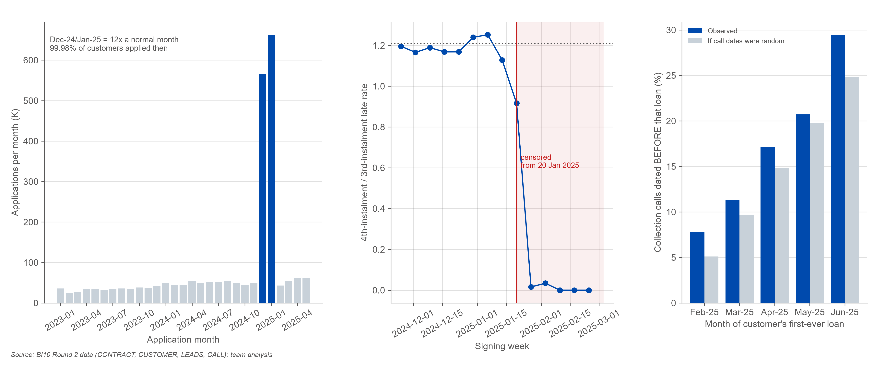
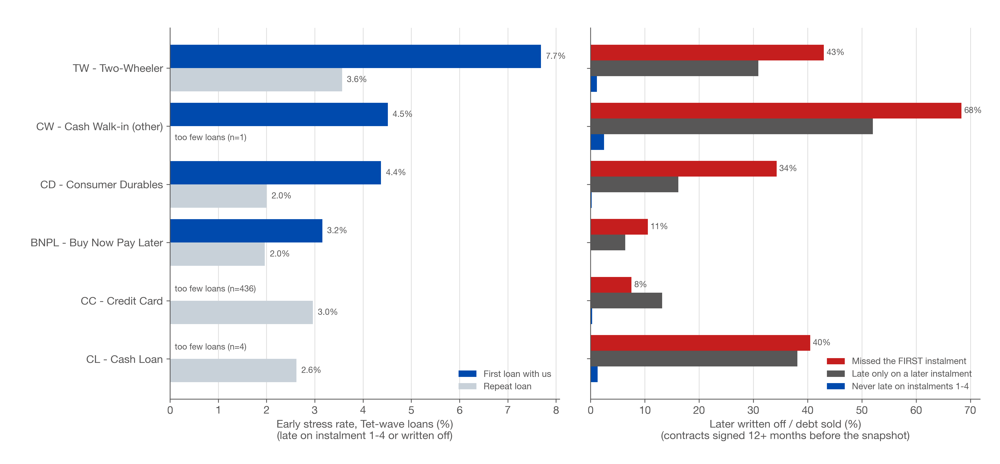
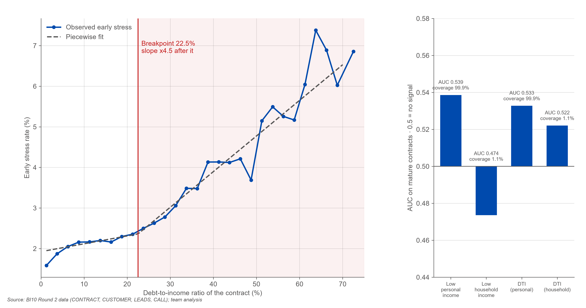
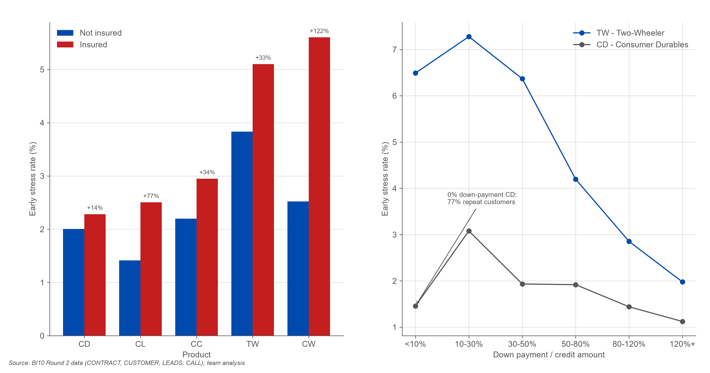
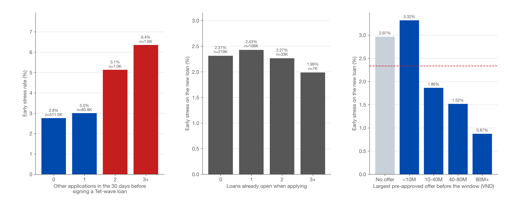
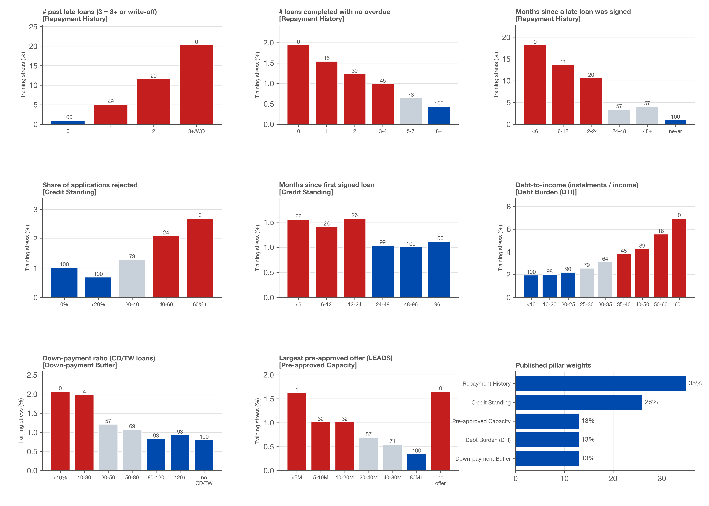
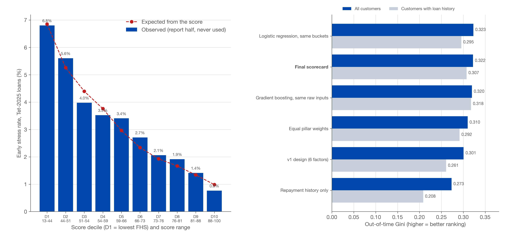
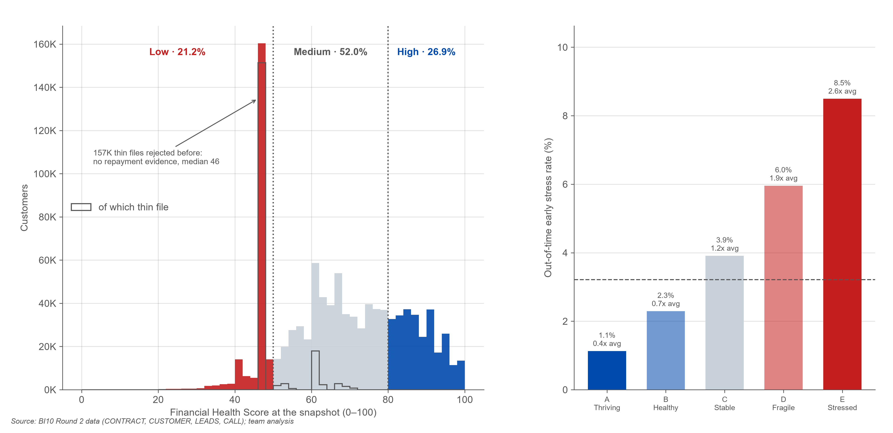
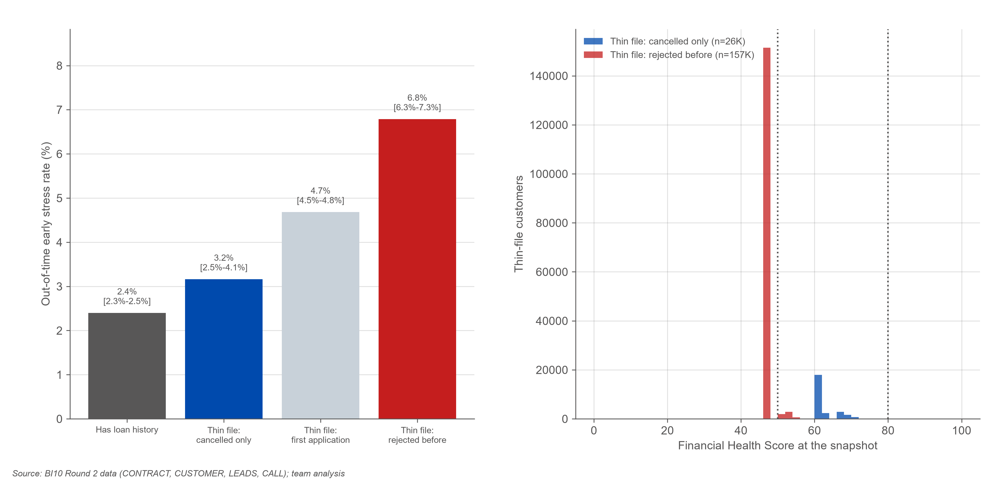
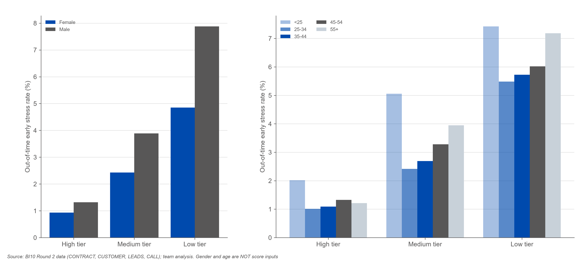

# Task 1 — Customer Financial Health Score

## Executive summary

- **The score ranks a period it never saw.** On 270,277 Tet-wave customers (report half), the lowest decile is stressed at 6.80% and the highest at 0.77% (8.9x); Gini 0.322, KS 0.238 — although the average stress rate jumped from 1.27% in training to 3.22%.
- **Better than v1, as good as complex models.** Gini 0.322 vs 0.301 for the v1 design (customers with history: 0.307 vs 0.261). A logistic regression that re-estimates every weight on the same buckets reaches 0.323 and gradient boosting on the same raw inputs 0.317: complexity buys little or nothing.
- **Three tiers with an economic meaning.** High (≥80): 268,670 customers (26.9%), out-of-time stress 1.13% (0.4x average). Moderate (50-79): 519,814 (52.0%), 3.10%. Low (<50): 212,044 (21.2%), 6.25% (1.9x).
- **First loans in the Tet wave are 2.1x as risky as repeat loans** (4.51% vs 2.19%); a first-time two-wheeler loan reaches 7.7%. Across all mature loans TW is the riskiest product (4.91%) and CD the safest (2.12%; z = 55).
- **'No history' hides two opposite profiles.** When they do get credit, customers previously *rejected* are stressed at 6.79%, while customers who only *cancelled* an application run at 3.16%, close to customers with history (2.40%); z = 6.0, p = 2e-09.
- **Loan stacking is a stress signal.** A Tet-wave loan signed after 2 other applications in the previous 30 days runs at 5.14%, and after 3+ at 6.36%, vs 2.76% with none (2.3x).
- **CALL dates cannot be used for before/after tests.** For customers whose first-ever loan came in May-2025, 20.7% of their collection calls are dated before that loan existed, against 19.7% expected if dates were random; 1,608 customers who never signed a loan received 5,922 collection calls; the collection share is 4.4%-4.5% in every one of 20 months; and 95% of collection-called customers were never late. Collection calls are therefore neither a score input nor a 'future' validation.
- **This holds for every call type, not only collection.** Only 4.1% of 'sign successful' calls fall within 14 days of an actual signing, and only 2.2% of consecutive calls to the same customer are less than a day apart, where a real dialler retries within hours. **Team-wide rule:** call dates are not used for any before/after test in Tasks 1-3; call counts and outcomes per customer, whose meaning does not depend on dates, remain usable (Task 2 responsiveness, Task 3 contact guards).

## Method

- **Features** frozen as of each window start (late flags only after 120 days, write-offs after 365 days, no future contract status). **Label**: late on instalment 1-4 or written off on loans signed in the window.
- **Training windows** 2023-10-01 to 2024-02-01, 2024-02-01 to 2024-06-01, 2024-06-01 to 2024-10-01 (354,105 customer-windows, stress 1.27%). **Out-of-time test** 2024-10-01 to 2025-01-20 (Tet wave, 541,128 customers), split into a selection half used only to anchor the 0-100 scale and a report half of 270,277.
- **Points**: monotone buckets, points linear in log-odds (100 = safest bucket, 0 = riskiest); pillar = mean of its factors; composite = published weights; FHS = composite on a risk-anchored scale (50 = 1.5x average stress, 80 = 0.5x, 18 points halve the odds); transparent policy caps for write-offs and current arrears.

| pillar | weight | factors |
|---|---|---|
| Repayment History | 35% | # past late loans (3 = 3+ or write-off), # loans completed with no overdue, Months since a late loan was signed |
| Credit Standing | 26% | Share of applications rejected, Months since first signed loan |
| Debt Burden (DTI) | 13% | Debt-to-income (instalments / income) |
| Down-payment Buffer | 13% | Down-payment ratio (CD/TW loans) |
| Pre-approved Capacity | 13% | Largest pre-approved offer (LEADS) |

## Evidence, chart by chart

### Data foundations: cohort, censoring, call timestamps

*Figure: Data foundations: cohort, censoring, call timestamps. Source: BI10 Round 2 data (CONTRACT, CUSTOMER, LEADS, CALL); team analysis.*

- **The file is a cohort, not the whole book.** 99.98% of the 1,000,528 customers applied in Dec-2024/Jan-2025, when monthly applications ran at 12x a normal month; 32% applied for the first time. Older vintages belong to customers who came back, so their stress rates are a survivor view; the score is therefore validated on the Tet wave itself.
- **Outcome flags are complete only for loans signed before 2025-01-20.** The 4th/3rd-instalment late-rate ratio is 1.21 in normal weeks and collapses for loans signed from 2025-01-20: those loans cannot have missed instalment 4 yet. Every label and contract comparison stops at this date (v1 used 2025-02-01).
- **CALL dates cannot be used for before/after tests.** For customers whose first-ever loan came in May-2025, 20.7% of their collection calls are dated before that loan existed, against 19.7% expected if dates were random; 1,608 customers who never signed a loan received 5,922 collection calls; the collection share is 4.4%-4.5% in every one of 20 months; and 95% of collection-called customers were never late. Collection calls are therefore neither a score input nor a 'future' validation.
- **This holds for every call type, not only collection.** Only 4.1% of 'sign successful' calls fall within 14 days of an actual signing, and only 2.2% of consecutive calls to the same customer are less than a day apart, where a real dialler retries within hours. **Team-wide rule:** call dates are not used for any before/after test in Tasks 1-3; call counts and outcomes per customer, whose meaning does not depend on dates, remain usable (Task 2 responsiveness, Task 3 contact guards).

### Product risk and roll rates

*Figure: Product risk and roll rates. Source: BI10 Round 2 data (CONTRACT, CUSTOMER, LEADS, CALL); team analysis.*

- **First loans in the Tet wave are 2.1x as risky as repeat loans** (4.51% vs 2.19%); a first-time two-wheeler loan reaches 7.7%. Across all mature loans TW is the riskiest product (4.91%) and CD the safest (2.12%; z = 55).
- **A missed first instalment is a different event per product.** It ends in write-off for 68% of CW loans but only 8% of CC loans. BNPL starts 59% of its late cases at instalment 1, yet only 27% roll to instalment 2 (CD: 62%): BNPL first-payment misses look like payment friction, instalment-loan misses like a loss of affordability.
- Never-late loans are written off at only 0.0%-2.5%: the first four instalments carry most of the repayment signal, which is why the Repayment pillar has the largest weight.

### Debt-burden tipping point

*Figure: Debt-burden tipping point. Source: BI10 Round 2 data (CONTRACT, CUSTOMER, LEADS, CALL); team analysis.*

- **Stress is almost flat until DTI ≈ 22.5%, then climbs 4.5x faster** (+0.19% vs +0.88% per 10 DTI points). Above the breakpoint the rate is 3.07% vs 2.15% below it (282,828 vs 2,090,330 contracts); above 40% it is 4.65%.
- **Personal income is the right denominator.** It covers 99.9% of contracts vs 1.1% for household income, and income level alone ranks weakly (AUC 0.539): affordability is about the instalment relative to income.

### Down payment and insurance

*Figure: Down payment and insurance. Source: BI10 Round 2 data (CONTRACT, CUSTOMER, LEADS, CALL); team analysis.*

- **Down payment protects most where the collateral is a vehicle.** TW loans with a 10-30% down payment are 2.3x as stressed as those with 50%+ (CD: 1.8x).
- **Zero down payment is not reckless on CD.** CD loans with <10% down payment run at 1.46%, about half the 10-30% band (3.08%); 77% of them go to repeat customers, consistent with 0% promotions reserved for proven clients. Down payment is evidence, not a linear rule.
- **Insurance marks risk, it does not remove it.** Insured contracts are more stressed for every product (CW 5.60% vs 2.52%; CL +77%) and in 100% of 12 product × DTI cells. It is not a score input: penalising insurance would discourage protection.

### Behaviour signals: stacking, selection paradox, pre-approved offer

*Figure: Behaviour signals: stacking, selection paradox, pre-approved offer. Source: BI10 Round 2 data (CONTRACT, CUSTOMER, LEADS, CALL); team analysis.*

- **Loan stacking is a stress signal.** A Tet-wave loan signed after 2 other applications in the previous 30 days runs at 5.14%, and after 3+ at 6.36%, vs 2.76% with none (2.3x).
- **The lender-selection paradox.** Customers with 3+ loans already open look *safer* on the new loan (1.99% vs 2.43% with one): the lender only tops up clients it trusts. A score fitted on this label would reward leverage, so the number of open loans is deliberately not a score input; leverage enters only through DTI, which is calibrated on single-contract affordability.
- **The lender's own pre-approved offer carries information the contract table does not.** Customers whose largest pre-approved offer was 80M+ VND run at 0.87%, vs 3.32% under 10M and 2.97% with no offer. It becomes the 'Pre-approved Capacity' pillar, held at 13% so the score does not simply echo past lender decisions.

### Scorecard points per factor

*Figure: Scorecard points per factor. Source: BI10 Round 2 data (CONTRACT, CUSTOMER, LEADS, CALL); team analysis.*

- **Negative drivers.** Late loans: training stress rises from 1.01% (none) to 5.06% (one) and 20.3% (3+ or write-off). A high rejection share (2.70% when 60%+ of applications were rejected vs 1.02% at 0%) and a recent late loan (18.18% if signed <6 months ago vs 1.01% if never late) pull the score down.
- **Positive drivers.** A clean completion record (0.43% at 8+ clean loans vs 1.94% at none), long history (1.12% at 8+ years vs 1.56% under 6 months) and a large pre-approved offer (0.35% at 80M+ vs 1.62% under 5M).
- **Scale.** Every 18 FHS points halve the odds of stress; 50 points = 4.72% expected stress (1.5x the Tet-window average of 3.15%), 80 points = 1.57%.
- **Thin files.** Customers with no signed loan take repayment and standing points from their type (cancelled only: 88 pts, first application: 85 pts, rejected before: 74 pts on the late-loan factor), instead of one 'no history' value.

### Out-of-time validation and benchmarks

*Figure: Out-of-time validation and benchmarks. Source: BI10 Round 2 data (CONTRACT, CUSTOMER, LEADS, CALL); team analysis.*

- **The score ranks a period it never saw.** On 270,277 Tet-wave customers (report half), the lowest decile is stressed at 6.80% and the highest at 0.77% (8.9x); Gini 0.322, KS 0.238 — although the average stress rate jumped from 1.27% in training to 3.22%.
- **Better than v1, as good as complex models.** Gini 0.322 vs 0.301 for the v1 design (customers with history: 0.307 vs 0.261). A logistic regression that re-estimates every weight on the same buckets reaches 0.323 and gradient boosting on the same raw inputs 0.317: complexity buys little or nothing.
- **The weights are not fragile.** Dropping any pillar changes Gini to 0.301-0.310; equal weights give 0.310; 200 random ±25% weight changes keep Gini within 0.313-0.323 and the customer ranking correlation ≥ 0.987.
- **Expected vs observed** stress per decile (orange line) tracks the bars, so the 0-100 scale doubles as an expected stress rate.

| model | gini_all | gini_history |
|---|---|---|
| v1 design (6 factors) | 0.301 | 0.261 |
| Repayment history only | 0.273 | 0.208 |
| Equal pillar weights | 0.31 | 0.292 |
| Logistic regression, same buckets | 0.323 | 0.295 |
| Gradient boosting, same raw inputs | 0.317 | 0.317 |
| Final scorecard | 0.322 | 0.307 |

### Score distribution, tiers and bands

*Figure: Score distribution, tiers and bands. Source: BI10 Round 2 data (CONTRACT, CUSTOMER, LEADS, CALL); team analysis.*

- **Three tiers with an economic meaning.** High (≥80): 268,670 customers (26.9%), out-of-time stress 1.13% (0.4x average). Moderate (50-79): 519,814 (52.0%), 3.10%. Low (<50): 212,044 (21.2%), 6.25% (1.9x).
- **Five bands for operations.** Stress climbs from band A (1.13%) to band E (8.50%), a 7.5x spread; band E holds 5,266 customers today.
- **Policy caps catch the worst cases.** 0.2% of the test sample hit a knock-out rule (write-off, overdue on an open loan, 2+ late loans) and were stressed at 16.3%.
- **Low no longer simply means 'no history'.** Thin-file customers are 71% of the Low tier (v1: 81%), and 30,973 thin-file customers sit above it. Score stability: PSI train→test 0.064, test→today for customers with history 0.104.

| band | n | bad_rate | x_average | customers_today |
|---|---|---|---|---|
| A Thriving | 58,211 | 1.13% | 0.35x | 268,670 |
| B Healthy | 82,397 | 2.29% | 0.71x | 284,314 |
| C Stable | 83,291 | 3.91% | 1.21x | 235,500 |
| D Fragile | 40,999 | 5.96% | 1.85x | 206,778 |
| E Stressed | 5,379 | 8.50% | 2.64x | 5,266 |

### Thin-file decomposition

*Figure: Thin-file decomposition. Source: BI10 Round 2 data (CONTRACT, CUSTOMER, LEADS, CALL); team analysis.*

- **'No history' hides two opposite profiles.** When they do get credit, customers previously *rejected* are stressed at 6.79%, while customers who only *cancelled* an application run at 3.16%, close to customers with history (2.40%); z = 6.0, p = 2e-09.
- **Today's thin-file base:** 156,891 rejected-before and 25,529 cancelled-only customers. Median FHS: rejected 46, cancelled 62.
- **Action split.** Rejected-before: education and a documented affordability check before any offer. Cancelled-only: they were approved and walked away — a service follow-up on why (price, product fit), not a stress treatment.

### Fairness: calibration within tiers

*Figure: Fairness: calibration within tiers. Source: BI10 Round 2 data (CONTRACT, CUSTOMER, LEADS, CALL); team analysis.*

- **Average scores are close; risk at the same score is not.** Mean FHS is 65.1 for women and 66.5 for men, but inside the Low tier men are stressed at 7.88% vs 4.85% for women (1.6x), and men are higher in every tier.
- **The score ranks inside every group** (Gini women 0.299, men 0.347; age bands 0.186-0.317). Under-25s are the weakest-ranked group, mostly because they are new to credit (Low-tier stress 7.42% vs 5.48% for 25-34).
- **Decision.** Gender and age stay out of the score (brief note 6): using them would price people by who they are. The gap is published as a monitoring item: women in the Low tier are, on evidence, closer to Moderate risk, so Low-tier actions must stay supportive (no automatic declines).

## Changes from v1 (audit trail)

1. Labels and contract comparisons stop at the censoring cut 2025-01-20 (was 2025-02-01).
2. Validation is genuinely out of time (earlier windows train, Tet wave tests) instead of a random split of one window.
3. New pillar *Pre-approved Capacity* (LEADS `MAX_OFFER`) and the factor *months since a late loan was signed*.
4. Thin files are split into rejected-before / cancelled-only / first application.
5. The 0-100 scale is anchored to risk, so the fixed 50/80 tier cut-offs mean 1.5x and 0.5x the average stress rate.
6. Production debt burden uses the real contract status (closed loans no longer count as open obligations).
7. The collection-call 'forward validation' was removed: CALL timestamps fail a timing test (chart 1).
8. Fairness is tested on calibration within tiers, not only on average scores.

## Limits

- The label sees instalments 1-4 only; later arrears are not observable in the contract table.
- The file is the Tet-2025 applicant cohort; older vintages are a survivor view.
- Product, insurance, down-payment and offer comparisons are associations, not causal effects.
- The pre-approved offer reflects the lender's own past judgement; its weight is held at 13% and should be monitored for feedback loops.
- Demographics are never inputs; they are used only for the fairness check.
